# GreenTree

Green-focused, high contrast themes for Zed: one light and three dark variants.

[English](README.md) · [简体中文](README.zh-CN.md) · [日本語](README.ja.md)

<table>
<tr>
<td align="center" width="50%">
<strong>Day Vivid</strong> 
<a href="docs/screenshots/day-vivid.jpg">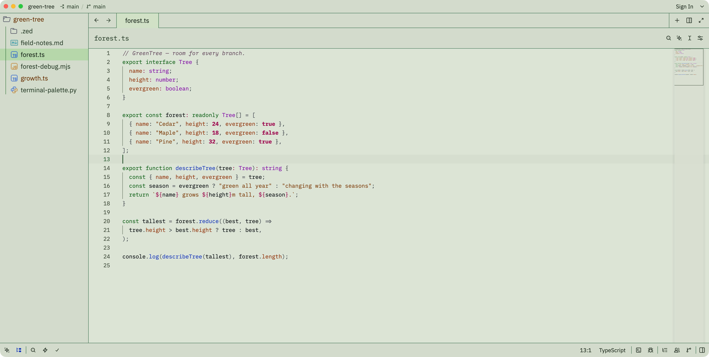</a> 
Warm ivory, vivid green, violet and pink
</td>
<td align="center" width="50%">
<strong>Day AAA</strong> 
<a href="docs/screenshots/day-aaa.jpg">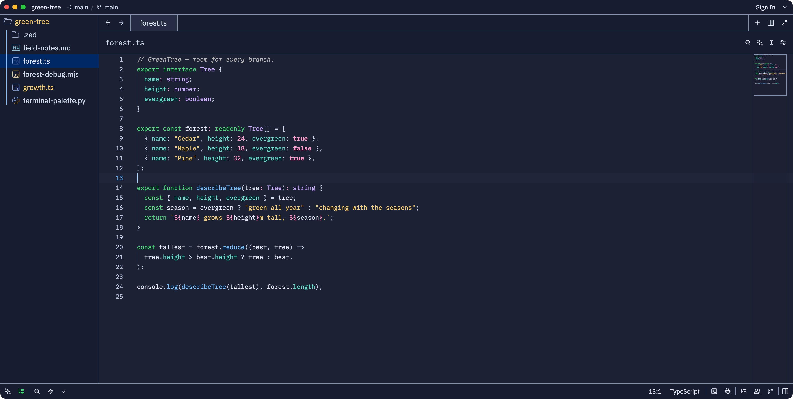</a> 
Deep indigo with bright syntax colors
</td>
</tr>
<tr>
<td align="center" width="50%">
<strong>Night AAA</strong> 
<a href="docs/screenshots/night.jpg">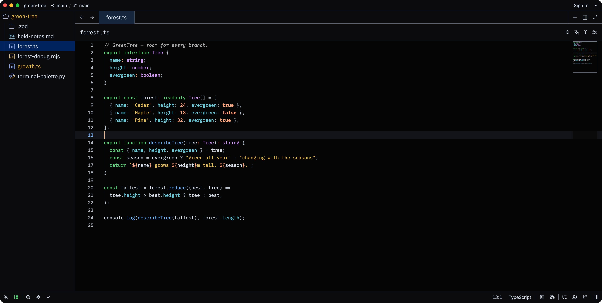</a> 
Near black, soft white and regular green keywords
</td>
<td align="center" width="50%">
<strong>Midnight AAA</strong> 
<a href="docs/screenshots/midnight.jpg">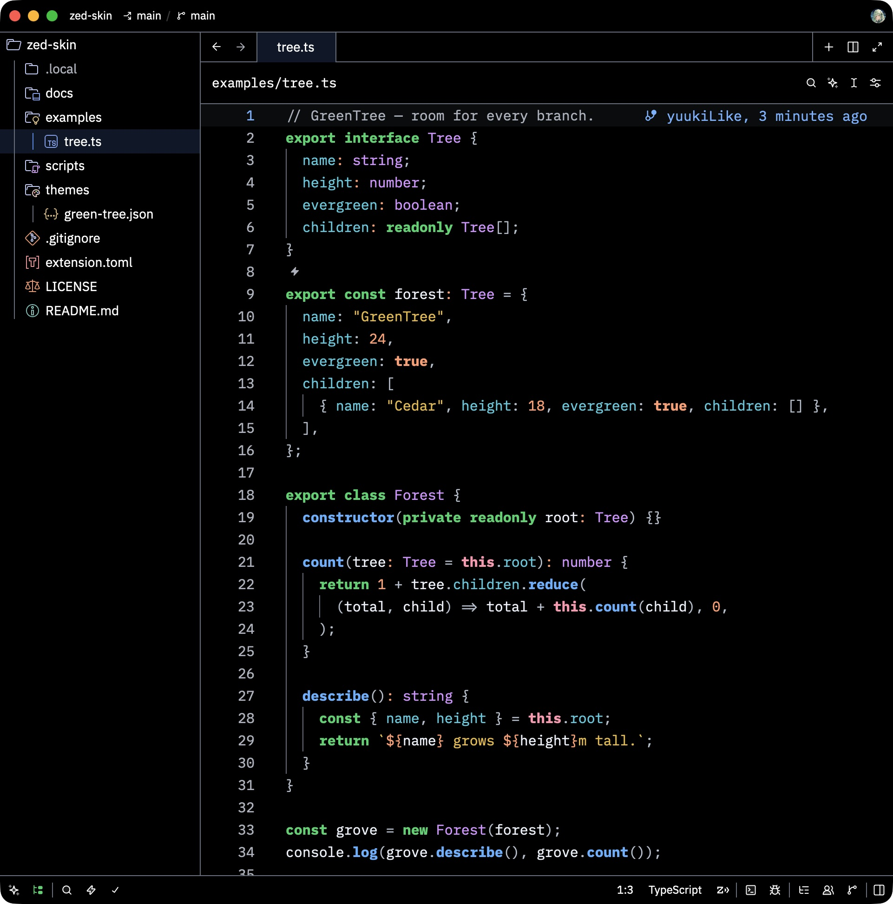</a> 
Pure black, bright white and bold green keywords
</td>
</tr>
</table>

The same English sample in every variant. Click any image to view it at full size.

## Install

In Zed's **Extensions**, search for **[GreenTree](https://zed.dev/extensions/green-tree-theme)** and install it. Run **`theme selector: toggle`** and choose a variant.

For manual installation, download [green-tree.json](themes/green-tree.json) into:

| Platform | Folder |
| --- | --- |
| macOS / Linux | `~/.config/zed/themes/` |
| Windows | `%USERPROFILE%\AppData\Roaming\Zed\themes\` |

Create the folder if needed, then reopen the theme selector. [Zed's theme guide](https://zed.dev/docs/themes).

## In action

### Debugger

A live Node.js session, paused on the green execution line, with a breakpoint, the selected stack frame and local variables visible.

<table>
<tr>
<td align="center" width="50%">
<strong>Day Vivid</strong> 
<a href="docs/screenshots/v0.11.2/day-vivid-debugger.jpg">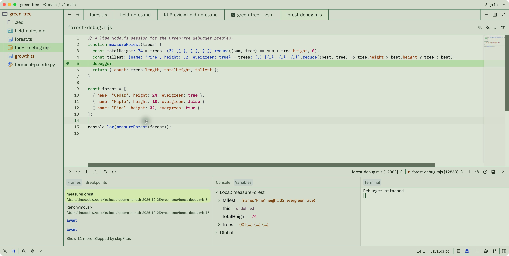</a>
</td>
<td align="center" width="50%">
<strong>Day AAA</strong> 
<a href="docs/screenshots/v0.11.2/day-aaa-debugger.jpg">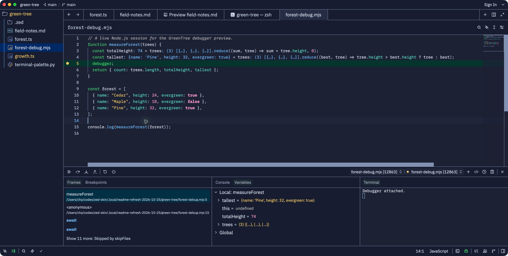</a>
</td>
</tr>
<tr>
<td align="center" width="50%">
<strong>Night AAA</strong> 
<a href="docs/screenshots/v0.11.2/night-debugger.jpg">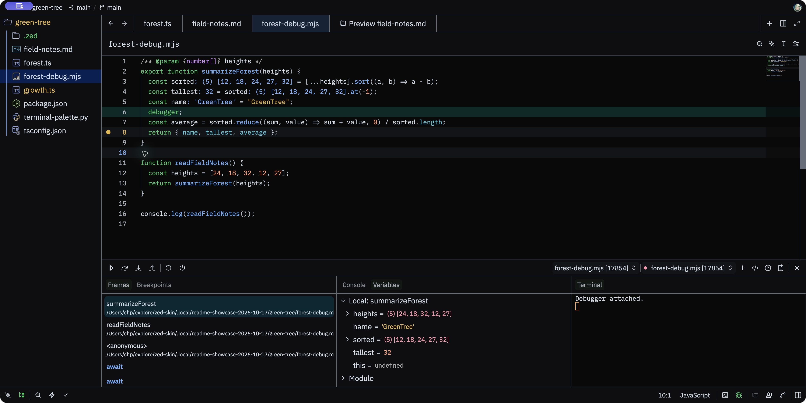</a>
</td>
<td align="center" width="50%">
<strong>Midnight AAA</strong> 
<a href="docs/screenshots/v0.11.2/midnight-debugger.jpg">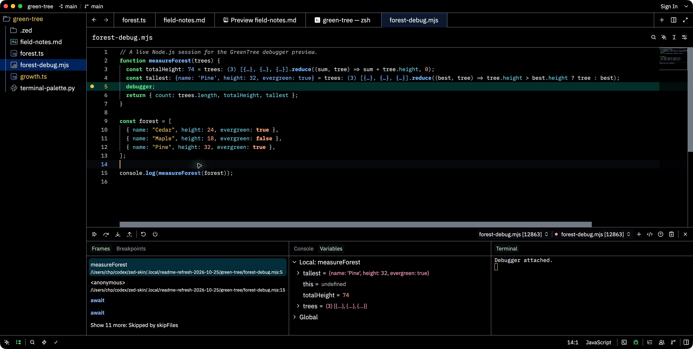</a>
</td>
</tr>
</table>

### More scenes

Expand a theme to compare Markdown, search and selection, Git diffs and terminal colors.

Day Vivid

<table>
<tr>
<td align="center" width="50%">
<strong>Markdown preview</strong> 
<a href="docs/screenshots/v0.11.2/day-vivid-markdown.jpg">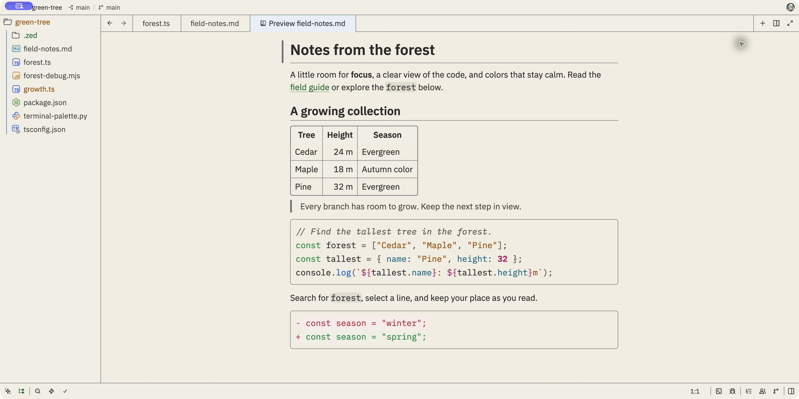</a>
</td>
<td align="center" width="50%">
<strong>Search and selection</strong> 
<a href="docs/screenshots/v0.11.2/day-vivid-search-selection.jpg">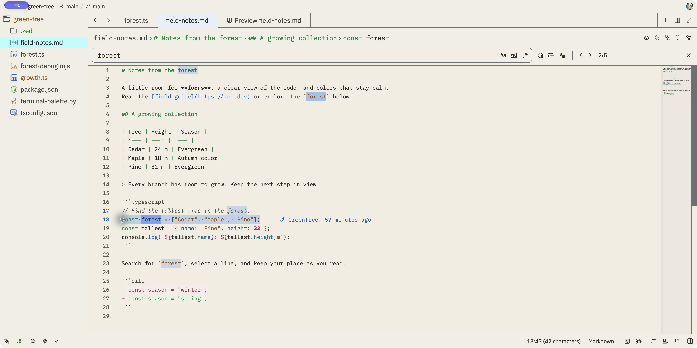</a>
</td>
</tr>
<tr>
<td align="center" width="50%">
<strong>Git diff</strong> 
<a href="docs/screenshots/v0.11.2/day-vivid-git-diff.jpg">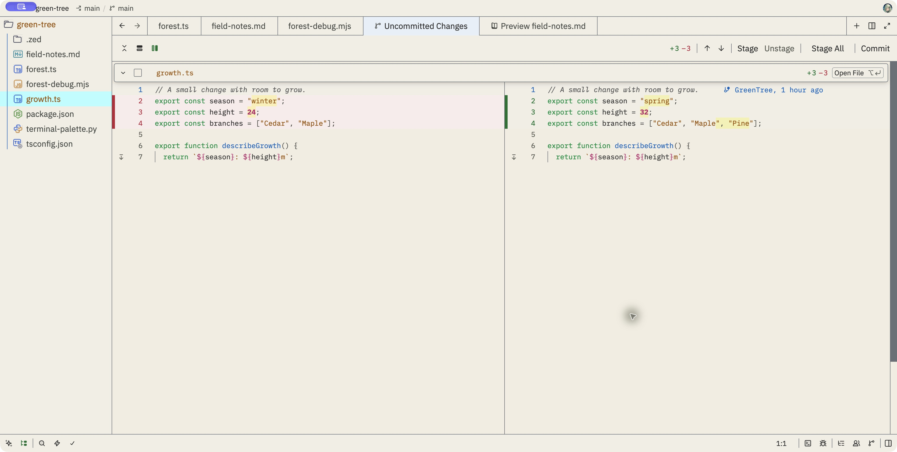</a>
</td>
<td align="center" width="50%">
<strong>Terminal and ANSI colors</strong> 
<a href="docs/screenshots/v0.11.2/day-vivid-terminal.jpg">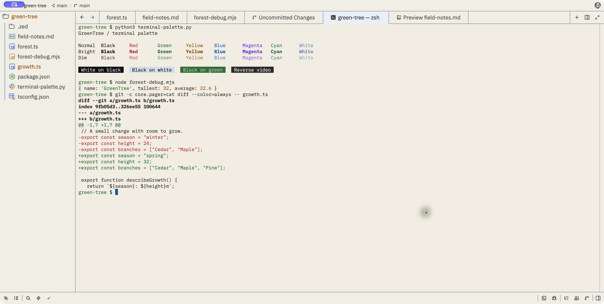</a>
</td>
</tr>
</table>

Day AAA

<table>
<tr>
<td align="center" width="50%">
<strong>Markdown preview</strong> 
<a href="docs/screenshots/v0.11.2/day-aaa-markdown.jpg">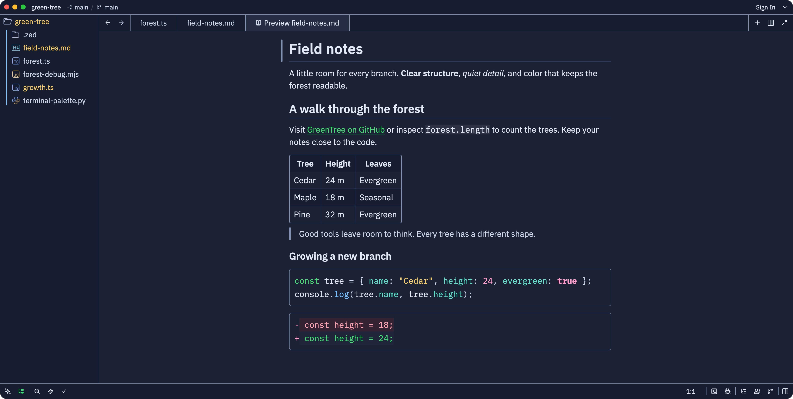</a>
</td>
<td align="center" width="50%">
<strong>Search and selection</strong> 
<a href="docs/screenshots/v0.11.2/day-aaa-search-selection.jpg">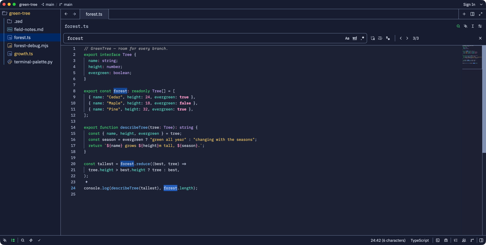</a>
</td>
</tr>
<tr>
<td align="center" width="50%">
<strong>Git diff</strong> 
<a href="docs/screenshots/v0.11.2/day-aaa-git-diff.jpg">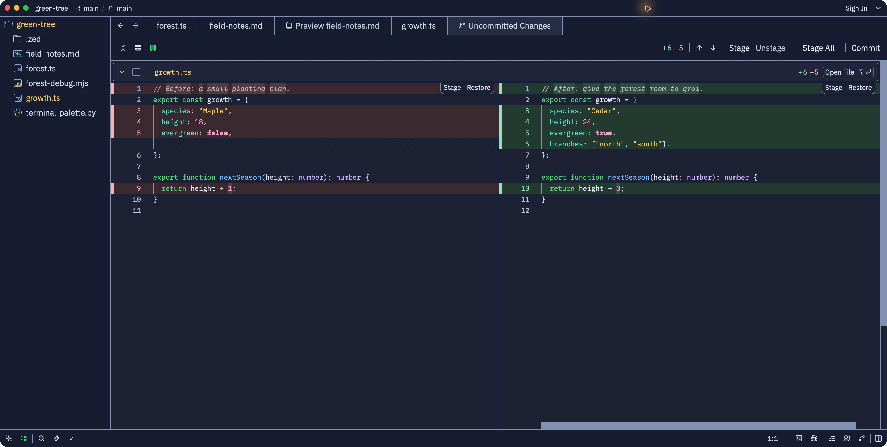</a>
</td>
<td align="center" width="50%">
<strong>Terminal and ANSI colors</strong> 
<a href="docs/screenshots/v0.11.2/day-aaa-terminal.jpg">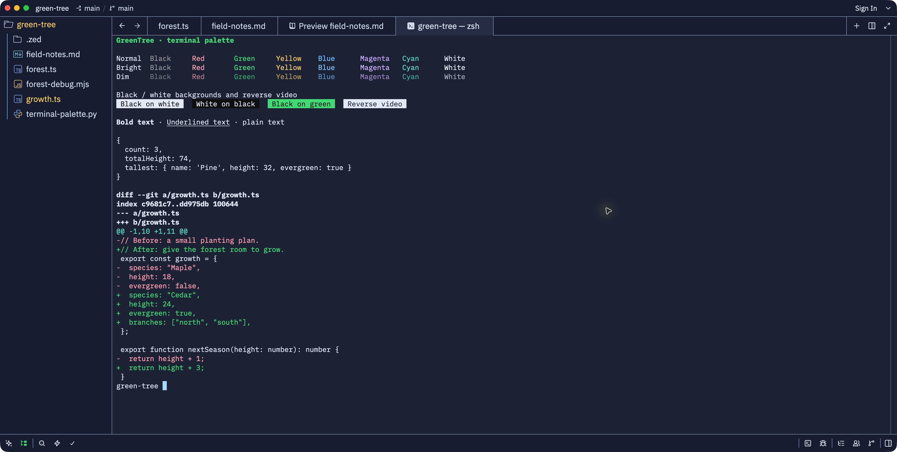</a>
</td>
</tr>
</table>

Night AAA

<table>
<tr>
<td align="center" width="50%">
<strong>Markdown preview</strong> 
<a href="docs/screenshots/v0.11.2/night-markdown.jpg">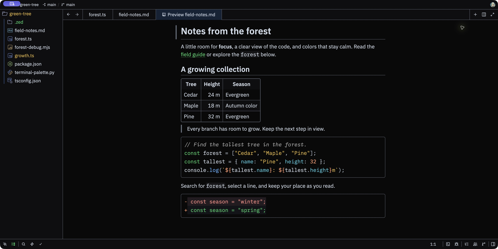</a>
</td>
<td align="center" width="50%">
<strong>Search and selection</strong> 
<a href="docs/screenshots/v0.11.2/night-search-selection.jpg">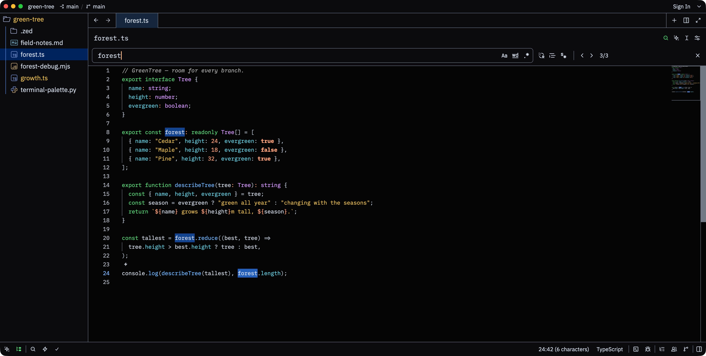</a>
</td>
</tr>
<tr>
<td align="center" width="50%">
<strong>Git diff</strong> 
<a href="docs/screenshots/v0.11.2/night-git-diff.jpg">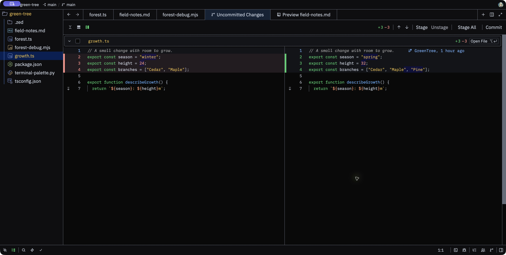</a>
</td>
<td align="center" width="50%">
<strong>Terminal and ANSI colors</strong> 
<a href="docs/screenshots/v0.11.2/night-terminal.jpg">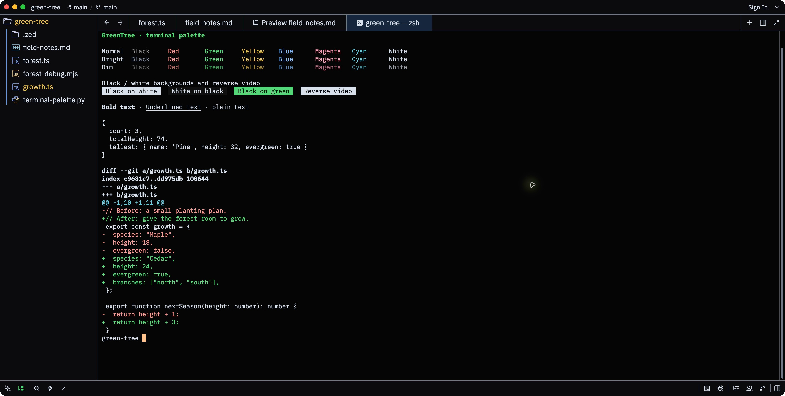</a>
</td>
</tr>
</table>

Midnight AAA

<table>
<tr>
<td align="center" width="50%">
<strong>Markdown preview</strong> 
<a href="docs/screenshots/v0.11.2/midnight-markdown.jpg">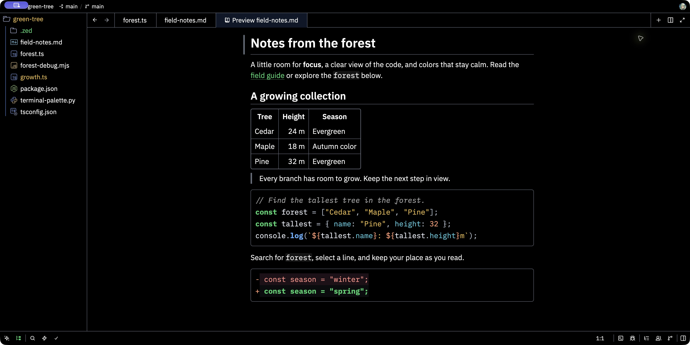</a>
</td>
<td align="center" width="50%">
<strong>Search and selection</strong> 
<a href="docs/screenshots/v0.11.2/midnight-search-selection.jpg">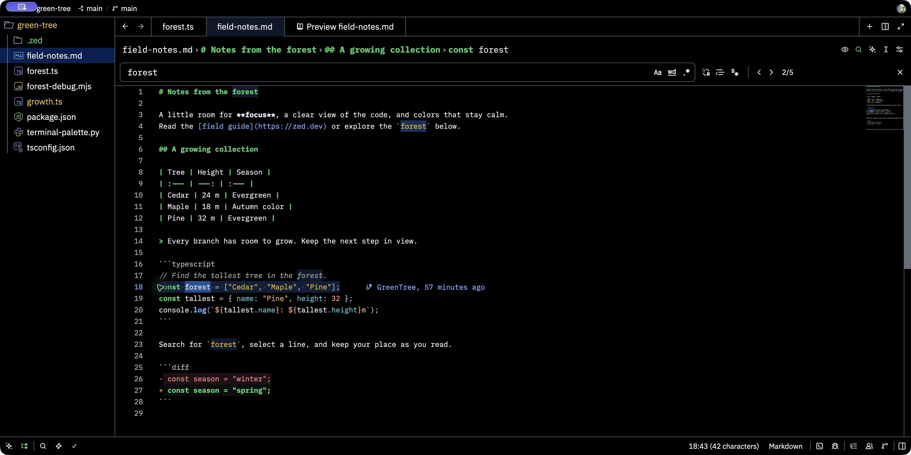</a>
</td>
</tr>
<tr>
<td align="center" width="50%">
<strong>Git diff</strong> 
<a href="docs/screenshots/v0.11.2/midnight-git-diff.jpg">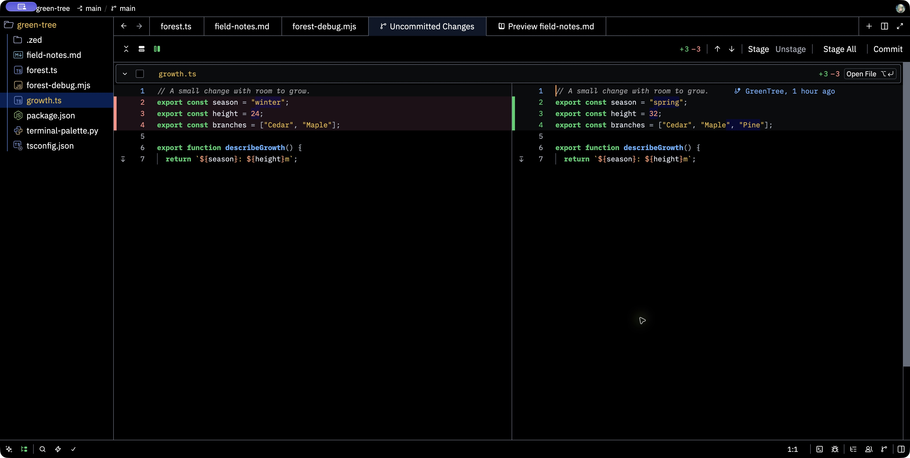</a>
</td>
<td align="center" width="50%">
<strong>Terminal and ANSI colors</strong> 
<a href="docs/screenshots/v0.11.2/midnight-terminal.jpg">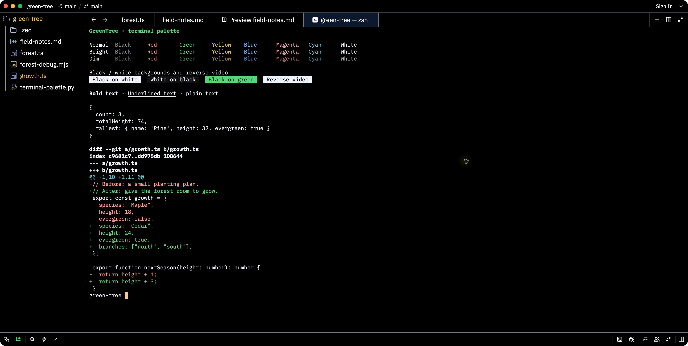</a>
</td>
</tr>
</table>

Captured with GreenTree 0.11.2 in Zed 1.24.2 on macOS. All screenshots use English UI and sample content; file icons come from the user's Zed setup. [Capture notes](docs/screenshots/README.md).

## Palette and checks

Dark variants target AAA 7:1 for primary text and AA 4.5:1 for comments. Search and selections share a blue hue and prioritize appearance and visibility, with no text contrast target. Day Vivid's green uses a custom 2.5:1 floor, below AA. These are palette targets, not whole-editor certification.

Dependency-free [checks](docs/theme-testing.md) cover search, selections, lists, Git diffs/conflicts, symbols, brackets, debugger highlights and ANSI black/white pairs.

[Manual QA](human-todo.md) · [Contrast report](docs/contrast-report.md) · [Palette notes](docs/palette-review.md) · [MIT License](LICENSE)
