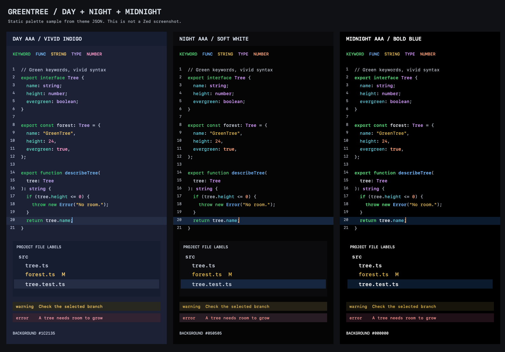

# GreenTree Contrast

**绿树 · 高对比度**：绿色重点文字，搭配天蓝、紫色与暖色语法，提供 Day、Night、Midnight 三种 Zed 主题。三款均以 WCAG AAA 的普通文字对比度（至少 7:1）为目标。

## 三种外观

| 主题名称 | 配色与字重 | 编辑器背景 | 最低文字对比度 |
| --- | --- | --- | ---: |
| `GreenTree Contrast Day AAA` | 深靛蓝底、默认字重鲜绿、天蓝函数、亮紫类型、薄荷青字段、金黄字符串、粉色数字 | `#1C2135` | 7.0721:1 |
| `GreenTree Contrast Night AAA` | 深黑、默认字重绿色、柔和冷白文字与文件名、橙色光标 | `#050505` | 7.3059:1 |
| `GreenTree Contrast Midnight AAA` | 纯黑编辑器和侧栏、加粗绿色与蓝色函数、纯白文件名、橙色光标 | `#000000` | 8.2937:1 |

Day 在 0.9.0 改为深靛蓝背景，让蓝绿文字更明亮的同时达到 7:1。绿色语法使用默认字重，函数和类型使用 500；普通变量为柔和冷白。保留用户喜欢的天蓝与紫色色相，并提高亮度以适配深底：光标和函数由 `#006AC4` 调整为 `#78C1FF`，类型由 `#7C3AED` 调整为 `#CCB0FF`。薄荷青字段、金黄字符串和粉色数字继续区分不同语法角色。

**当前三款在 Zed 中都归类为深色主题。** Day 使用带色彩的靛蓝底，Night 使用中性深黑，Midnight 使用纯黑；Day 名称表示这款较明亮的日间配色，不再表示白色界面。

Night 的绿色语法不指定字重，白色调为柔和冷白 `#D8E1EC`；Midnight 保留亮白文字，绿色语法至少使用 600 字重，蓝色函数、方法与构造函数也加粗至 600。两者共用天蓝函数、亮紫类型、金黄字符串、杏橙数字和青蓝字段。注释仍用较暗的灰色，保留阅读层次。

Zed 普通未选中文件名使用 `text.muted`，不是只使用 `text`。Night 将这两个字段设为柔和冷白 `#D8E1EC`，Midnight 则设为纯白 `#FFFFFF`。这会同时影响其他使用 `text.muted` 的界面文字；语法注释单独配色。Git 修改、新增、删除和忽略状态仍使用各自的颜色。

旧名称 **`GreenTree Contrast AAA`** 继续作为 Night 的完全相同配色保留，所以选择器中有四个名称、三种实际外观。0.7 / 0.8 的 **`GreenTree Contrast Day AA`** 已由 **`GreenTree Contrast Day AAA`** 取代。

关键词：**green · tree · high contrast · AAA contrast · day · night · midnight · indigo · sky blue · pure black · Zed theme · 绿色 · 树 · 高对比度 · 靛蓝 · 天蓝 · 深夜 · 纯黑 · 无障碍配色**。

## 安装与选择

macOS / Linux：在本仓库根目录执行：

```sh
mkdir -p ~/.config/zed/themes
cp -i themes/green-tree-contrast.json ~/.config/zed/themes/
```

在 Zed 中按 `⌘K`、`⌘T`（Linux 为 `Ctrl+K`、`Ctrl+T`），搜索 **GreenTree Contrast**，选择 Day AAA、Night AAA 或 Midnight AAA。也可以在命令面板执行 `theme selector: toggle`。如果新名称尚未出现在列表中，重新启动 Zed。

Windows：将同一个 JSON 文件复制到 `%USERPROFILE%\AppData\Roaming\Zed\themes\`，重启后在主题选择器中选择。

已有设置如果引用 `GreenTree Contrast Day AA`，需要改为 `GreenTree Contrast Day AAA`。如果希望系统日间使用靛蓝 Day、系统夜间使用 Night，可将下面的 `theme` 字段合并到现有 `settings.json`；其中 `light` 只指定系统浅色模式时选用的主题，Day 本身仍是深色配色：

```json
{
  "theme": {
    "mode": "system",
    "light": "GreenTree Contrast Day AAA",
    "dark": "GreenTree Contrast Night AAA"
  }
}
```

也可以把 `dark` 改为 `GreenTree Contrast Midnight AAA`。系统外观只有浅色和深色两个槽位，第三种主题可在选择器中手动切换；主题本身不运行定时任务。

语言服务可能额外淡化未使用代码。如需保留主题设定的文字颜色，可以在现有设置中加入 `"unnecessary_code_fade": 0.0`。

本目录也包含 `extension.toml`，可通过 `zed: install dev extension` 选择本目录加载。纯主题不需要 Rust、Node.js 或编译。发布到扩展市场时再填写实际仓库地址及许可证。

## 配色

| 用途 | Day AAA | Night / Midnight AAA |
| --- | --- | --- |
| 正文、普通变量 | `#E2E9F5` 冷白 | Night `#D8E1EC`；Midnight `#EFF4FB` |
| 关键字、标题、重点文字 | `#40D975` 鲜绿 | `#54D878` 鲜绿 |
| 函数、构造函数 | `#78C1FF` 天蓝 | `#70B9FF` 天蓝 |
| 类型、命名空间 | `#CCB0FF` 亮紫 | `#D99CFF` 亮紫 |
| 字符串 | `#F5CC69` 金黄 | `#E9C04F` 金黄 |
| 数字、常量、布尔值 | `#FF9ECD` 粉色 | `#FFA47A` 杏橙 |
| 对象字段 | `#5FDDC9` 薄荷青 | `#62CFDF` 青蓝 |
| 内置函数、特殊字符串 | `#5FDDC9` 薄荷青 | `#62CFDF` 青蓝 |
| 标点、运算符 | `#CED8EB` 蓝灰 | `#BDC7D3` 冷灰 |
| 注释、行号 | `#BEC8DF` 蓝灰 | `#B5BBC5` 浅灰 |
| 错误 | `#FFA4B3` 珊瑚粉 | `#FF9993` 珊瑚红 |
| 本地光标 | `#78C1FF` 天蓝 | `#FFAD66` 橙色 |

编辑器、侧栏、补全菜单、搜索、diff、终端、协作光标和 Vim / Helix 模式标识均有显式配色。窗口和承载文字的背景使用不透明颜色，避免壁纸或背后的窗口改变对比度。缩略图的视口使用透明填充和清晰边框，保持代码可见。



样张从主题 JSON 离屏绘制，包含普通和已修改文件名的颜色示意。它不是 Zed 截图；语法片段由样张指定，实际着色范围由语言语法与 Zed 决定。另见 [浅底 Day 与当前靛蓝 Day 对照](docs/day-aaa-comparison.png) 和 [配色迭代记录](docs/palette-review.md)。

## 对比度验证与范围

运行检查只需要 Python 3，无第三方依赖：

```sh
python3 scripts/check_contrast.py
python3 scripts/check_contrast.py --report docs/contrast-report.md
```

检查直接读取主题 JSON，使用 WCAG 的 sRGB 相对亮度公式和**未舍入**的计算值判断。Day、Night、Midnight 与旧名称的普通文字均至少 **7:1**，关键边框、图标和光标至少 **3:1**。阈值按名称明确列出，未知主题不会自动采用较低要求。

每个名称检查 11,365 个组合，合计 45,460 个，覆盖界面文字、语法、注释、行号、终端前景及默认、选区、当前行、括号匹配、搜索、弹出层和 diff 背景。无效颜色、遗漏字段、未分类的新字段、重复 JSON 键或不合格对比度都会返回非零退出码。透明占位边框不计作可见标识。详细结果见 [对比度报告](docs/contrast-report.md)。用 [tree.ts](examples/tree.ts) 可以预览 TypeScript 的语法颜色。

早期版本曾在 macOS 的 Zed 1.21.0 中实际加载，字段已对照官方 v0.2.0 Schema 与当前源码核实。本次完成文件检查、对比度审计、阈值回归检查和静态样张检查；按用户要求未操作 Zed，实际观感由用户检查。

**名称中的 AAA 描述已检查的文字颜色组合，不表示整个 Zed 应用获得 WCAG 认证。** 主题无法完整控制焦点面积、键盘操作、读屏支持、选区与相邻背景的区别或插件自定义渲染。运行时额外的混色、透明度、用户主题覆盖及语言服务淡化需要按实际效果评估。数值检查也不等于持续阅读舒适度保证。

终端的 normal、bright 和 dim ANSI 前景均针对默认底色和主题选区检查。三款的 bright 提亮，dim 降低对比度，但仍保持至少 7:1。终端程序自行指定的 ANSI 背景、256 色或真彩色不在保证范围内；依赖传统黑色背景槽的 TUI 可能需要调整自己的配色。

## 文件

- `themes/green-tree-contrast.json`：主题本体，可单独安装。
- `extension.toml`：本地开发扩展清单。
- `scripts/check_contrast.py`：可重复运行的颜色审计。
- `docs/contrast-report.md`：当前 JSON 的检查结果。
- `docs/palette-review.md`：配色参考、变更历史与验收范围。
- `docs/three-modes-preview.png`：当前三种外观的静态样张。
- `docs/day-aaa-comparison.png`：当前靛蓝 Day 与上一版浅底 Day 的对照。
- `docs/day-warm-comparison.png`：0.8.0 Day 暖中性浅底与冷白的历史对照。
- `docs/day-aa-comparison.png`：0.7.0 Day 从 AAA 改为 AA 的历史对照。
- `docs/ice-day-night-preview.png`、`docs/day-night-preview.png`、`docs/palette-comparison.png`：历史样张。
- `examples/tree.ts`：语法配色示例。

规范参考：[Zed 主题与本地安装](https://zed.dev/docs/themes)、[Theme JSON Schema](https://zed.dev/schema/themes/v0.2.0.json)、[WCAG AA 文字对比度](https://www.w3.org/WAI/WCAG22/Understanding/contrast-minimum.html)、[AAA 文字对比度](https://www.w3.org/WAI/WCAG22/Understanding/contrast-enhanced.html)、[非文字对比度](https://www.w3.org/WAI/WCAG22/Understanding/non-text-contrast.html)。字段依据[官方主题定义](https://github.com/zed-industries/zed/blob/main/crates/settings_content/src/theme.rs)补全；文件名配色依据[标签颜色选择](https://github.com/zed-industries/zed/blob/main/crates/editor/src/items.rs)和 [UI 颜色映射](https://github.com/zed-industries/zed/blob/main/crates/ui/src/styles/color.rs)核实。
