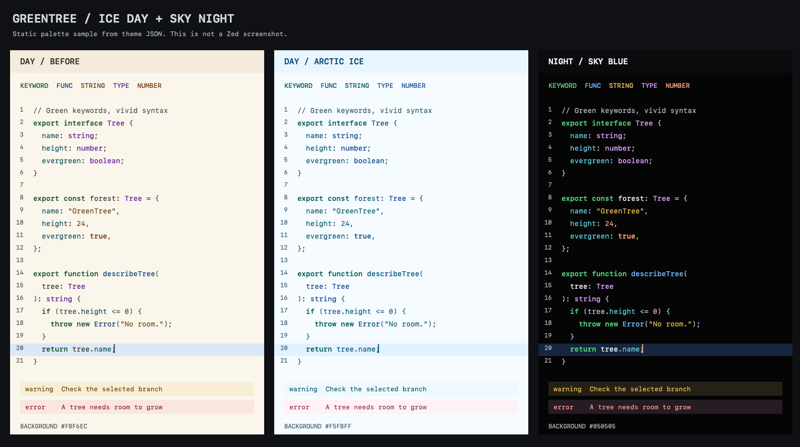

# GreenTree Contrast AAA

**绿树 · 高对比度** — 绿色重点文字、冰川日间与深黑夜间两套 Zed 主题，以 WCAG AAA 的普通文字对比度为配色目标。

Day 以蓝天和北极冰川为配色方向：冰白背景、浅冰蓝侧栏与选区，常规文字全部采用蓝青色系，关键字用青绿、函数用海蓝、类型用宝蓝、字符串用湖青。Night 保留 RepoBar 参考带来的清晰颜色语义：鲜绿关键字、天蓝函数、亮紫类型、金黄字符串与杏橙数字。两款的错误文字使用红色提示，背景均没有绿色调。关键字适度加粗，函数与类型略加字重，注释不使用斜体。

Day 的蓝青文字比参考图标里的亮蓝、鲜绿更深，这是用户在“冰白背景”和“AAA 文字对比度”之间选定的组合。Night 的正文、变量和常规目录名使用从用户截图采样得到的冷白 `#EFF4FB`；本地光标采用橙色 `#FFAD66`，注释保留稍暗的层次。数值检查不等于舒适度保证，实际感受还受字号、屏幕亮度与环境光影响。

关键词：**green · tree · high contrast · AAA contrast · day · night · arctic · glacier · sky blue · ice white · black · Zed theme · 绿色 · 树 · 高对比度 · 冰川 · 天蓝 · 冰白 · 深黑 · 无障碍配色**。

## 白天与夜晚

| 主题名称 | 使用场景 | 编辑器背景 | 正文对比度 |
| --- | --- | --- | ---: |
| `GreenTree Contrast Day AAA` | 白天，冰白与蓝青色系 | `#F5FBFF` | 8.93:1 |
| `GreenTree Contrast Night AAA` | 夜晚，深黑背景 | `#050505` | 18.44:1 |

Day 为浅色主题，Night 为深色主题。两款保持语法角色与字重一致，配色分别适配浅底和深底；例如类型在 Day 使用宝蓝，在 Night 使用亮紫。

原来的 **`GreenTree Contrast AAA`** 名称继续可用，配色与 **Night** 完全一致，已有设置可以直接沿用。

## 安装

macOS / Linux：在本仓库根目录执行：

```sh
mkdir -p ~/.config/zed/themes
cp -i themes/green-tree-contrast.json ~/.config/zed/themes/
```

在 Zed 中按 `⌘K`、`⌘T`（Linux 为 `Ctrl+K`、`Ctrl+T`），搜索 **GreenTree Contrast**，选择 **Day AAA** 或 **Night AAA**。也可以在命令面板执行 `theme selector: toggle`。如果尚未出现在列表中，重新启动 Zed。

Windows：将同一个 JSON 文件复制到 `%USERPROFILE%\AppData\Roaming\Zed\themes\`，重启后在主题选择器中选择。

如需固定使用深黑夜间主题，并避免语言服务把未使用代码额外淡化，将下面两个字段合并到现有 `settings.json`：

```json
{
  "theme": "GreenTree Contrast Night AAA",
  "unnecessary_code_fade": 0.0
}
```

也可以跟随系统外观，在系统浅色模式时使用冰白 Day、深色模式时使用深黑 Night：

```json
{
  "theme": {
    "mode": "system",
    "light": "GreenTree Contrast Day AAA",
    "dark": "GreenTree Contrast Night AAA"
  },
  "unnecessary_code_fade": 0.0
}
```

`system` 跟随操作系统的外观设置；按时间自动切换由系统控制，主题本身不运行定时任务。

本目录也包含 `extension.toml`，可通过 `zed: install dev extension` 选择本目录加载。纯主题不需要 Rust、Node.js 或编译。发布到扩展市场时再填写实际仓库地址及许可证。

## 配色

| 用途 | Day | Night |
| --- | --- | --- |
| 正文、变量、常规目录名 | `#004B73` 海蓝 | `#EFF4FB` 截图冷白 |
| 关键字、标题、重点文字 | `#005956` 青绿 | `#54D878` 鲜绿 |
| 字符串、警告 | `#005765` 湖青 | `#E9C04F` 金黄 |
| 函数、构造函数 | `#005480` 海蓝 | `#70B9FF` 天蓝 |
| 链接 | `#005480` 海蓝 | `#80BBFF` 浅蓝 |
| 类型、命名空间 | `#174B94` 宝蓝 | `#D99CFF` 亮紫 |
| 数字、常量、布尔值 | `#194F90` 蓝色 | `#FFA47A` 杏橙 |
| 正则、特殊变量 | `#165378` 湖蓝 | `#EB9DD9` 粉紫 |
| 对象字段、内置函数、特殊字符串 | `#00556D` 青蓝 | `#62CFDF` 青蓝 |
| 标点、运算符 | `#19536F` 蓝灰 | `#BDC7D3` 冷灰 |
| 注释、次要文字、行号 | `#2C536A` 蓝灰 | `#B5BBC5` 中性灰 |
| 错误 | `#8C2A46` 莓红 | `#FF9993` 珊瑚红 |
| 焦点、活动边框 | `#2374B8` 蓝色 | `#5C98EA` 蓝色 |
| 本地光标 | `#005480` 蓝色 | `#FFAD66` 橙色 |

编辑器、侧栏、补全菜单、搜索、diff、终端、协作光标和 Vim / Helix 模式标识均有显式配色。窗口和承载文字的背景使用不透明颜色，避免壁纸或背后的窗口改变对比度。缩略图的视口使用透明填充和清晰边框，保持代码可见。

下图由主题 JSON 离屏绘制，展示上一版暖白 Day、当前冰白 Day 与当前 Night。它是静态配色样张，不是 Zed 截图；语法片段由样张指定，实际着色范围由语言语法与 Zed 决定。



配色参考、当前调整与历史检查结果见 [配色迭代记录](docs/palette-review.md)。

## 对比度验证与范围

运行检查只需要 Python 3，无第三方依赖：

```sh
python3 scripts/check_contrast.py
python3 scripts/check_contrast.py --report docs/contrast-report.md
```

检查直接读取主题 JSON，使用 WCAG 的 sRGB 相对亮度公式和**未舍入**的计算值判断：普通文字至少 **7:1**，关键边框、图标和光标至少 **3:1**。透明占位边框不计作可见标识。无效颜色、遗漏字段、未分类的新字段、重复 JSON 键或不合格的对比度都会返回非零退出码。

检查分别覆盖 Day、Night 和兼容名称，包括默认背景，以及选区、当前行、括号匹配、搜索、弹出层和 diff 背景。详细结果见 [对比度报告](docs/contrast-report.md)。用 [tree.ts](examples/tree.ts) 可以预览 TypeScript 的语法颜色。

早期版本曾在 macOS 的 Zed 1.21.0 中实际加载，字段已对照官方 v0.2.0 Schema 与当前源码核实。本次配色更新完成了文件检查、对比度审计和静态样张检查；按用户要求未操作 Zed，当前版本在应用中的观感由用户验收。

**名称中的 AAA 描述已检查的文字颜色组合，不表示整个 Zed 应用获得了 WCAG AAA 认证。** 焦点面积、键盘操作、读屏支持、选区与相邻背景的区分方式及插件的自定义渲染不由主题 JSON 完整控制。Zed 运行时额外的颜色混合或透明度、用户的主题覆盖，以及语言服务淡化都需要在实际使用时另行评估。

终端的普通、bright 和 dim ANSI 前景均针对默认底色和主题选区检查。为了让 ANSI black 的文字在深色底上也清晰可见，black 映射为中性浅灰。终端程序自行设置的 ANSI 背景、256 色或真彩色输出不在保证范围内；依赖传统黑色背景槽的 TUI 可能需要调整自己的配色。

终端配色分别适配浅底和深底：Night 的 bright 彩色略微提亮、Day 的 bright 略微加深，以增加各自背景上的对比度；dim 降低对比度但仍保留至少 7:1，因此部分 dim 与普通色的差异较小。Night 的普通与 bright 白色统一使用截图冷白，Day 的白色槽转为可读的蓝色文字。Day 的 ANSI 黄与品红槽也采用蓝青色系。

## 文件

- `themes/green-tree-contrast.json`：主题本体，可单独安装。
- `extension.toml`：本地开发扩展清单。
- `scripts/check_contrast.py`：可重复运行的颜色审计。
- `docs/contrast-report.md`：从当前 JSON 生成的检查结果。
- `docs/palette-review.md`：RepoBar 参考依据、配色变更历史与验收范围。
- `docs/ice-day-night-preview.png`：当前版本的日夜静态配色样张。
- `docs/day-night-preview.png`：0.4.0 暖白 Day 的历史配色样张。
- `docs/palette-comparison.png`：0.3.0 的历史配色样张。
- `examples/tree.ts`：语法配色示例。

规范参考：[Zed 主题与本地安装](https://zed.dev/docs/themes)、[Zed Theme JSON Schema](https://zed.dev/schema/themes/v0.2.0.json)、[WCAG 2.2 文字增强对比度](https://www.w3.org/WAI/WCAG22/Understanding/contrast-enhanced.html)、[WCAG 2.2 非文字对比度](https://www.w3.org/WAI/WCAG22/Understanding/non-text-contrast.html)。部分较新的 Zed 字段依据[官方主题字段定义](https://github.com/zed-industries/zed/blob/main/crates/settings_content/src/theme.rs)补全。
