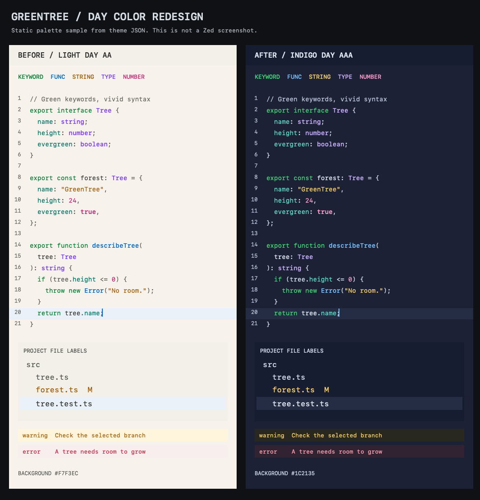
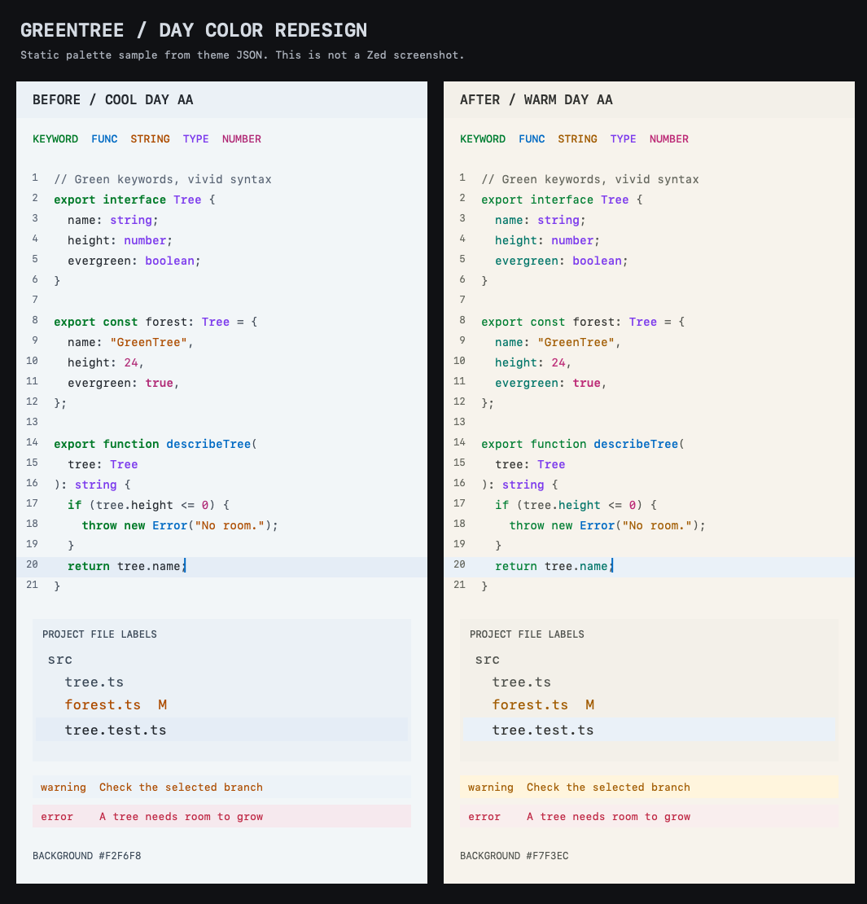
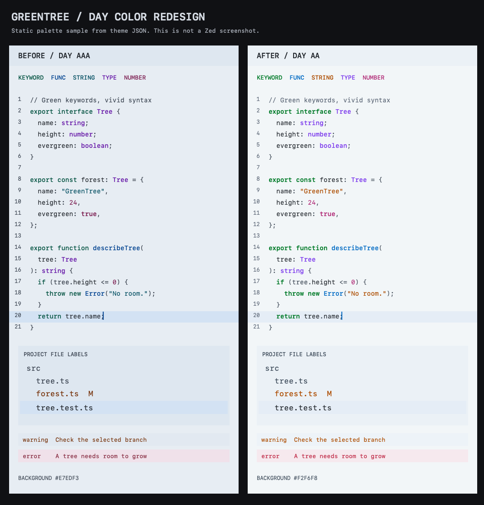
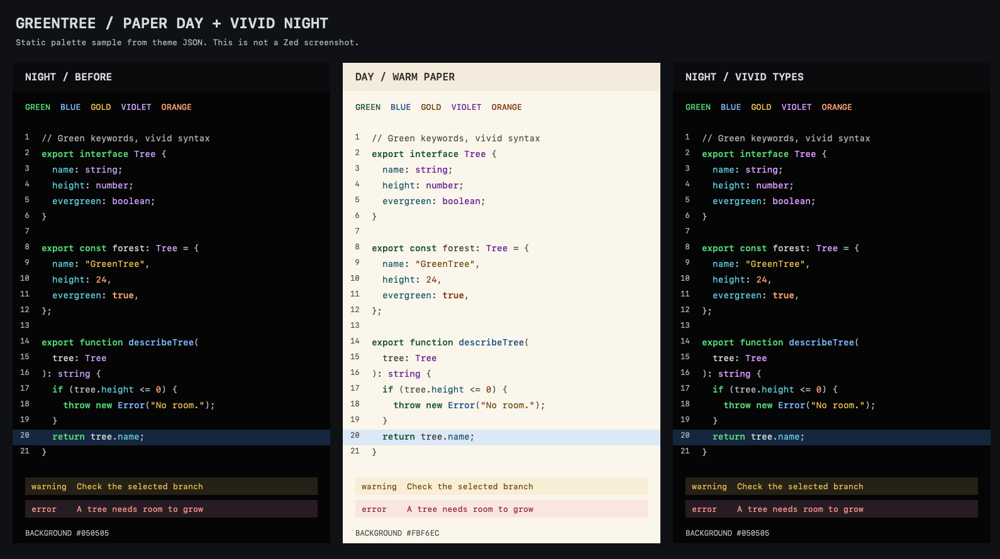
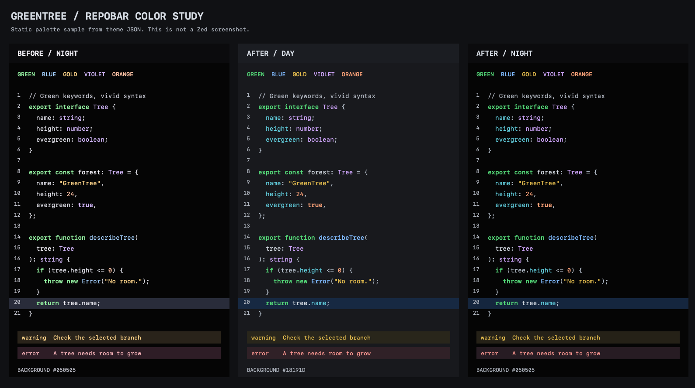

# 配色迭代记录

## 0.9.0：鲜亮蓝绿与 7:1，Day 改为靛蓝深底

用户进一步要求蓝绿文字更鲜亮，不能通过把文字往黑色调整来提高对比度，并允许继续修改背景直到达到 7:1。本版将 Day 从暖中性浅底改为 `#1C2135` 深靛蓝，侧栏和顶栏使用 `#171D30`，同时提高蓝绿、紫色、粉色、金黄和薄荷青的文字亮度。Day 恢复名称 `GreenTree Contrast Day AAA`，在 Zed 中归类为深色主题。

用户喜欢的蓝与紫保留色相方向，亮度随深底调整。函数和光标蓝由 `#006AC4` 改为 `#78C1FF`，HSV 色相均约 207.6°；类型紫由 `#7C3AED` 改为 `#CCB0FF`，色相从约 262.1° 变为 261.3°。这是保持色相的亮度适配，并非保持原始 RGB 值。绿色改为 `#40D975`，仍使用默认字重。

| Day 语法角色 | 当前颜色 | 0.8 主背景对比度 | 0.9 主背景对比度 | 0.9 选区对比度 |
| --- | --- | ---: | ---: | ---: |
| 绿色关键字 | `#40D975` | 4.7108:1 | 8.6473:1 | 7.4441:1 |
| 天蓝函数 | `#78C1FF` | 4.9204:1 | 8.2458:1 | 7.0984:1 |
| 紫色类型 | `#CCB0FF` | 5.1521:1 | 8.5120:1 | 7.3276:1 |
| 金黄字符串 | `#F5CC69` | 4.7326:1 | 10.4099:1 | 8.9614:1 |
| 粉色数字 | `#FF9ECD` | 5.0286:1 | 8.3623:1 | 7.1988:1 |
| 薄荷青字段 | `#5FDDC9` | 5.0706:1 | 9.6126:1 | 8.2751:1 |

上述前后对比均使用各版自己的前景与背景。蓝绿的计算相对亮度提高，背景亮度降低，因此文字本身更亮、明暗对比也更高。暖浅底 0.8 仍保存于工作区候选与历史样张，便于对照。

Day 的最低界面／语法文字对比度为 7.0984:1，包含终端 dim 颜色后的最低文字对比度为 7.0721:1，关键非文字标识最低 4.2923:1。Night、Midnight 与旧名称的主题对象和 0.8 完全一致。每个名称 11,365 个组合、合计 45,460 个组合全部通过；额外验证蓝紫色相、绿色默认字重、终端深色亮度顺序，以及低对比度负例仍被拒绝。

本版已导入本地主题目录，并迁移现有设置中的 `Day AA` 名称引用。静态样张不等于应用截图；没有使用 computer-use，实际观感由用户检查。基线、候选与样张脚本保存在 `.local/day-aaa/`。最新已提交检查点仍为 `ed98470`，本轮没有创建新提交。

## 0.8.0：独立设计暖中性 Day，区分 Night 与 Midnight 的白色和字重（历史记录）

用户选择 Day 保留明亮界面、改用暖中性浅底，并明确喜欢现有天蓝光标与类型紫色。本版保留 `players[0].cursor = #006AC4` 以及所有类型类捕获的 `#7C3AED` 配色和字重，重新处理背景、绿色字重与辅助色：

- 主背景改为 `#F7F3EC`，侧栏为 `#F3F0E9`；从编辑器、工具栏到菜单、终端均使用暖中性浅底。蓝色选区保留在局部，不再作为大面积底色。
- 绿色改为 `#007E32`，所有绿色语法移除显式字重，跟随编辑器默认值。
- 参考用户图标中的明快绿色、薄荷青、橙黄色相，字段和内置函数改用薄荷青 `#007568`，字符串与警告改用橙金 `#A15B00`。原始图标中的 `#00B753`、`#FEB500` 等亮色不能直接作为满足浅底 AA 的普通文字，所以保留色相方向、调整亮度。
- 新加入粉色 `#BD2B77`，用于数字、常量、布尔值及部分转义字符；搜索高亮与调试活动行采用淡黄色 `#FFF1CC`。
- Night 的正文、变量与普通文件名由 `#EFF4FB` 收敛为 `#D8E1EC`，计算相对亮度降低约 17.2%。Midnight 保持亮白正文与纯白文件名，并将天蓝函数、方法及构造函数加粗至 600。

| 0.8.0 主题 | 最低文字对比度 | 最低关键非文字对比度 | 正文／主背景 | 普通文件名／侧栏 |
| --- | ---: | ---: | ---: | ---: |
| Day AA | 4.5325:1 | 3.6919:1 | 11.8217:1 | 7.0824:1 |
| Night AAA | 7.3059:1 | 3.4640:1 | 15.4327:1 | 14.8899:1 |
| Midnight AAA | 8.2937:1 | 3.9324:1 | 19.0034:1 | 21.0000:1 |

连同 Night 的旧名称，共检查 45,460 个组合，沿用 Day AA、Night / Midnight AAA 的阈值，全部通过。另确认 Day 已喜欢的光标和紫色完全保持、绿色不再加粗、Night 仅调整白色前景、Midnight 仅改变三类蓝色函数的字重，以及终端 normal / bright / dim 层次与兼容名称一致。

以上为离屏静态样张，不是 Zed 截图。0.8.0 已同步本地主题文件；本轮没有操作应用，也没有改动用户正在选择的主题设置。实际暖底观感与舒适度交由用户检查。基线、候选和样张脚本位于忽略目录 `.local/warm-day/`。最新已提交检查点仍为 `ed98470`，后续修改留在工作区。

## 0.7.0：鲜亮 Day AA 与真正生效的夜间白色文件名（历史记录）

用户反馈 0.6.0 的 Day 文字仍趋近深色、缺少活力，并明确选择将 Day 调整为 AA，Night / Midnight 保持 AAA。Day 因此改名为 `GreenTree Contrast Day AA`，不再保留误导性的 Day AAA 名称。

Day 主底色由灰蓝 `#E7EDF3` 改为柔和淡冷白 `#F2F6F8`，侧栏为 `#EBF1F6`。它比 0.6.0 更明亮，但主背景的计算相对亮度仍比被反馈刺眼的 0.5.0 `#F5FBFF` 低约 4.2%；这不是屏幕实测亮度或舒适度结论。通过区分色相，减少原先大片深蓝青文字的观感：

| 语法角色 | 0.6.0 Day AAA | 0.7.0 Day AA |
| --- | --- | --- |
| 关键字 | `#00513F` 深青绿 | `#007A28` 鲜绿，字重 600 |
| 函数 | `#004290` 深蓝 | `#006AC4` 天蓝 |
| 类型 | `#6414A6` 深紫 | `#7C3AED` 亮紫 |
| 字符串 | `#004D60` 深青 | `#AD4C00` 暖橙 |
| 数字 | `#7D1F52` 暗玫红 | `#B02875` 玫红 |

普通变量保持中性墨色，注释改为较轻的蓝灰。终端 ANSI 色同步更新，normal / bright / dim 均满足 Day 的 AA 目标，并保留正确的亮度顺序。关键非文字标识仍至少 3:1。

夜间文件名显灰的原因已在 [Zed 标签颜色选择](https://github.com/zed-industries/zed/blob/main/crates/editor/src/items.rs)及 [UI 颜色映射](https://github.com/zed-industries/zed/blob/main/crates/ui/src/styles/color.rs)中确认：普通未选中文件名使用 `Color::Muted`，映射到 `text.muted`。0.5 / 0.6 仅提高 `text` 无法覆盖该状态。0.7 将 Night 的 `text.muted` 改为 `#EFF4FB`、Midnight 改为 `#FFFFFF`，和各自 `text` 一致。对这两款而言，本轮仅修改该字段，保留语法注释、橙色光标和 Git 状态颜色。其他使用 `text.muted` 的界面标签也会变亮。

| 0.7.0 主题 | 文字目标 | 最低文字对比度 | 最低关键非文字对比度 | 普通文件名／侧栏 |
| --- | ---: | ---: | ---: | ---: |
| Day AA | 4.5:1 | 4.5592:1 | 3.1480:1 | 8.0904:1 |
| Night AAA | 7:1 | 7.3059:1 | 3.4640:1 | 17.7950:1 |
| Midnight AAA | 7:1 | 8.2937:1 | 3.9324:1 | 21.0000:1 |
| 旧名称兼容项 | 7:1 | 7.3059:1 | 3.4640:1 | 17.7950:1 |

审计脚本按主题名称明确指定阈值，未知名称报错。每个名称仍检查 11,365 个组合，共 45,460 个，全部通过。额外回归检查确认：AA 范围的颜色在 Day 通过、同一配色按 AAA 检查失败，低于 AA 的文字仍失败；同时核对 Night / Midnight 仅改变文件名所用字段、注释保持灰色、绿色字重差异、终端层次及旧名称完全一致。完整结果见 [当前对比度报告](contrast-report.md)。

样张从 JSON 离屏绘制，文件名示意使用本次查证的字段；它们不是 Zed 截图。没有使用 computer-use。当前文件已同步到本地主题目录，现有设置中的 Day 名称引用也已迁移。实际鲜亮感、文件名观感和持续阅读舒适度仍需用户在 Zed 中验收。

此前按用户要求提交的检查点为 `ed98470`（0.5.0）。之后的三形态和本轮修改保留在工作区，没有创建新提交。0.7 基线、候选及离屏绘制脚本保存在被忽略的 `.local/vivid-day/`。

## 0.6.0：三种形态与 Day 多色尝试（历史记录）

在提交 `ed98470` 后增加 Midnight：编辑器和侧栏采用纯黑 `#000000`，`text` 采用纯白，绿色语法至少加粗至 600。Night 绿色语法移除显式字重，跟随编辑器默认值；旧名称继续与 Night 相同。

Day 从 0.5 的冰白与蓝青语法改为灰蓝白 `#E7EDF3`，正文为中性墨色，关键字、函数、类型、数字分别使用深青绿、深蓝、紫色、玫红，仍要求 AAA。最低文字对比度为 7.0895:1。用户实际反馈它仍偏暗、缺乏活力，因此被 0.7 的 Day AA 取代。此版没有修复普通未选中文件名使用 `text.muted` 的问题；该问题在 0.7 查明并修正。

## 0.5.0：冰白 Day、天蓝函数与截图冷白文字（历史记录）

Day 参考用户提供的 macOS 蓝色图标，以蓝天和北极冰川为方向。用户明确选择“冰白底＋较深蓝青，保留 AAA”：主底色 `#F5FBFF`、侧栏 `#EAF6FF`、选区 `#E2F2FF`，正文采用海蓝 `#004B73`，关键字采用偏青的绿色 `#005956`，类型采用宝蓝 `#174B94`。移除暖纸底及常规语法中的棕黄、焦橙、浓紫色；错误文字仍用莓红区分。

Night 的调整限定在用户要求的文字与本地光标：

- 函数、方法和构造函数从 `#80BBFF` 改为更饱和的天蓝 `#70B9FF`。
- 用户截图中，目录与编辑器正文区域的主要白色像素均为 `#EFF4FB`，直接采用该值。`text`、`editor.foreground`、普通变量及其他原有正文色统一更新，让常规目录名与正文一起变白。
- 注释与次要文字从 `#AFB5BF` 提至 `#B5BBC5`，标点从 `#B7C1CD` 提至 `#BDC7D3`，保留层次。
- 本地光标改为橙色 `#FFAD66`；深黑底色、类型紫色、选区和远端协作者光标继续沿用 0.4.0。
- 终端普通白与 bright 白都使用截图冷白，避免普通白更新后比 bright 白更亮。

| 当前主题 | 最低文字对比度 | 最低关键非文字对比度 | 正文／主背景 |
| --- | ---: | ---: | ---: |
| Day | 7.1059:1 | 3.7250:1 | 8.9288:1 |
| Night | 7.3059:1 | 3.4640:1 | 18.4436:1 |
| 旧名称兼容项 | 7.3059:1 | 3.4640:1 | 18.4436:1 |

每个名称仍检查 11,365 个组合，全部保留文字 ≥ 7:1、关键非文字标识 ≥ 3:1 的阈值。Night 橙色块光标与块内反色文字的对比度为 11.0848:1。另核对 Night 的变更范围、普通文字与目录的共同前景色、Day 蓝青语法范围、终端 normal / bright / dim 层次和旧名称一致性。完整结果见 [当前对比度报告](contrast-report.md)。

样张从主题 JSON 离屏绘制，并示意本地光标颜色；它不是 Zed 截图，语法片段由样张指定。未进行 computer-use。数值及静态样张检查不替代用户在实际 Zed 中对颜色、目录文字和光标的验收。

当前配色已同步本地安装，修改保留在工作区。此前提交 `8a24898` 保存的是 0.3.0。本轮候选与取色结果位于被忽略的 `.local/ice-day/`。

## 0.4.0：暖白 Day 与更鲜明的 Night 类型紫色（历史记录）

先以提交 `8a24898` 保存 0.3.0，再调整本版配色。当前修改保留在工作区供用户检查。

Day 从炭灰改为真正的浅色主题：暖白纸面 `#FBF6EC`、奶油色侧栏 `#F5EBDD`、暖墨色正文 `#302D28` 和浅蓝选区 `#DCE8F7`。语法、菜单、状态、diff、终端和光标全部转为适合浅底的颜色；绿色只用于重点文字和成功语义。

Night 保留现有底色、界面和其他语法颜色，仅将 `type`、`type.builtin`、`enum`、`namespace`、`variant`、`attribute` 的紫色从 `#D2A8FF` 改为 `#D99CFF`，并将 `type` 与 `type.builtin` 的字重设为 500。新紫色提高饱和度，相对亮度略低于原色。Day 的同类类型使用浓紫 `#652398`，同样采用 500 字重。

| 0.4.0 主题 | 外观 | 最低文字对比度 | 最低关键非文字对比度 |
| --- | --- | ---: | ---: |
| Day | 浅色 | 7.1076:1 | 4.3661:1 |
| Night | 深色 | 7.3619:1 | 3.4640:1 |
| 旧名称兼容项 | 与 Night 相同 | 7.3619:1 | 3.4640:1 |

检查范围与阈值保持不变，每个名称仍检查 11,365 个组合。审计脚本新增浅色外观支持，同时继续要求不透明背景；低对比度组合仍失败。Night 的变更范围及旧名称一致性另作检查。以上数值属于 0.4.0；最新结果见 [当前对比度报告](contrast-report.md)。

该图由主题 JSON 离屏绘制，不是 Zed 截图；语法着色片段由样张指定。本次没有操作应用、浏览器或剪贴板。文件与静态样张已检查，实际显示、字号和持续阅读舒适度由用户在自己的屏幕上验收。

## 0.3.0：RepoBar 参考与三轮配色调整（历史记录）

本轮完成 3 次候选调整，采纳第 3 轮并同步本地安装。文件与数值验收通过；Zed 中的实际视觉效果和持续使用舒适度待用户检查。本轮没有操作应用、浏览器或剪贴板，也没有进行独立评审。

### 目标与约束

- 文字至少 7:1、关键非文字标识至少 3:1，沿用原有对比度检查的全部组合与阈值。
- 主要语法颜色比旧版更容易区分：固定比较 keyword、function、string、type、number 五种颜色，要求最小及平均 OKLab 色差均增加。
- 控制亮度：这五种颜色的平均相对亮度、正文和边框的相对亮度不增加；避免终端纯白高亮和 dim 比普通色更亮的倒置。这些是配色控制措施，不构成对眼部健康或实际舒适度的保证。
- 保留 Day 炭灰 `#18191D`、Night 深黑 `#050505`，无绿色背景，绿色只用于重要文字及成功语义；保留旧主题名、所有字段与语法捕获。

### 参考依据

参考用户本地收藏 `my-ui-collect/sites/repobar.app/README.md` 及其 Hero、产品截图。该记录中的主要参考色为品牌绿 `#39D353`、选中蓝 `#2F81F7`、运行黄 `#FFC832`、错误红 `#FF6459`。

借鉴的是中性暗背景、明确的颜色语义，以及有限的强调色。原站的绿色光晕、绿背景与绿色边框不适用于本次用户偏好，未采用。原站蓝色和红色不能直接作为本主题的 AAA 小字颜色，因此按本主题的背景重新调整了亮度。

旧版辅助色偏浅，且对象字段没有彩色强调。新版提高色彩纯度，把字符串与数字分为金黄和杏橙，对象字段使用青蓝，函数保留蓝色并略加字重。正文和标点退为灰白，以减轻满屏泛白的观感。

### 每轮观察、纠正与验证

| 轮次 | 观察与修改 | 验证结果 |
| --- | --- | --- |
| 1 | 辅助色偏粉白；提高绿、蓝、黄、紫、橙等前景色的饱和度。 | 原有对比度组合全部通过；五种主色的平均色差增加约 23%，平均相对亮度降低约 13%。字符串与数字仍较接近，继续调整。 |
| 2 | 金黄与橙色进一步分开；对象字段改青蓝，布尔值改杏橙；正文、边框与高亮背景降低亮度，选区改暗蓝。 | 原有对比度组合全部通过；最接近的主色对色差提高约 52%。无绿色背景、日夜主底色及兼容名称检查通过。 |
| 3 | 普通终端色更新后，旧 dim 和 bright 色仍偏白，部分 dim 比普通色更亮；重配全部 ANSI 变体，以灰白替代纯白。 | 所有 ANSI 颜色满足 dim 相对亮度 ≤ 普通色 ≤ bright，文字对比度仍全部通过；离屏样张可见新增的青蓝字段与更明确的金黄／橙色。 |

所有轮次都使用同一审计脚本、颜色组合和阈值。最终选择第 3 轮，因为它保留了第 2 轮的主色改善，并修正了终端亮度层级。

### 基线与最终测量

| 指标 | 修改前 | 最终版 | 解释 |
| --- | ---: | ---: | --- |
| 五种主色的最小 OKLab 色差 × 100 | 6.5751 | 9.9795 | 增加约 52%；两版最接近的均为字符串与数字。 |
| 五种主色的平均 OKLab 色差 × 100 | 15.4624 | 20.7747 | 增加约 34%。 |
| 五种主色的平均相对亮度 | 0.6445 | 0.5069 | 降低约 21%。 |
| 正文相对亮度 | 0.8791 | 0.7036 | 降低约 20%。 |
| 边框相对亮度 | 0.2445 | 0.1888 | 降低约 23%。 |
| Day 最低文字对比度 | 7.1205:1 | 7.1108:1 | 均 ≥ 7:1；允许降低过强的亮度，保持原阈值。 |
| Night 最低文字对比度 | 7.9051:1 | 7.3872:1 | 均 ≥ 7:1。 |
| Day 最低非文字对比度 | 3.5007:1 | 3.3344:1 | 均 ≥ 3:1。 |
| Night 最低非文字对比度 | 3.8865:1 | 3.4640:1 | 均 ≥ 3:1。 |

OKLab 色差为线性 sRGB 转换后的欧氏距离，以 ×100 表示；五种颜色等权，计算所有 10 个颜色对。它只用于同一任务中比较配色的区分程度，既不是 WCAG 指标，也不能推导“实际可读性提高了多少”或色觉差异用户的表现。相对亮度取值范围为 0–1，不是屏幕实测亮度，也未按实际代码中各颜色的面积加权。

最终每个主题名称检查 11,365 个组合，Day、Night 与旧名称共计 34,095 个组合，全部通过。Night 与旧名称的样式完全一致，两种日夜配色的语法前景色及字重一致。这些历史数据对应 0.3.0（提交 `8a24898`）；当前版本的结果见 [对比度报告](contrast-report.md)。

### 静态样张与剩余验收

样张由主题 JSON 离屏绘制，没有使用 computer-use；它并非 Zed 截图，语法着色片段由样张指定，不能验证 Zed 的实际捕获、语言服务淡化或渲染混色。本轮只完成静态样张的自查，没有应用内视觉检查或用户舒适度测量。

停止原因：达到用户指定的 3 轮上限，数值条件已通过。用户需在自己的屏幕上检查实际代码颜色、选区可见性和长时间阅读感受；不据此声称“绝不刺眼”或整体 WCAG AAA 认证。

原始版本及三轮候选保存在本工作区被忽略的 `.local/repobar-loop/`；未自动提交或发布。
